# Detecção de defeitos em placas de circuito impresso com YOLO26

Detector de objetos que localiza e classifica **6 tipos de defeito em trilhas de PCB** (open, short, mousebite, spur, cobre espúrio e pin-hole), treinado sobre o dataset público **DeepPCB** a partir dos pesos pré-treinados (COCO) do YOLO26n, **inteiramente em CPU**.

> Projeto da disciplina de Inteligência Artificial — Engenharia Elétrica, CEFET-MG.

| | |
|---|---|
| **mAP50** (500 imagens de validação) | **0.967** |
| **mAP50-95** | **0.697** |
| Precisão / Revocação | 0.938 / 0.926 |
| Melhor F1 | 0.93 com confiança ≥ 0.50 |
| Modelo | YOLO26n — 2.5 M parâmetros, 5.5 MB |
| Inferência | ~30 ms por imagem (832 px) em CPU |
| Treino | 91 épocas, 6.0 h, CPU AMD Ryzen 9 9950X3D |

<p align="center">
  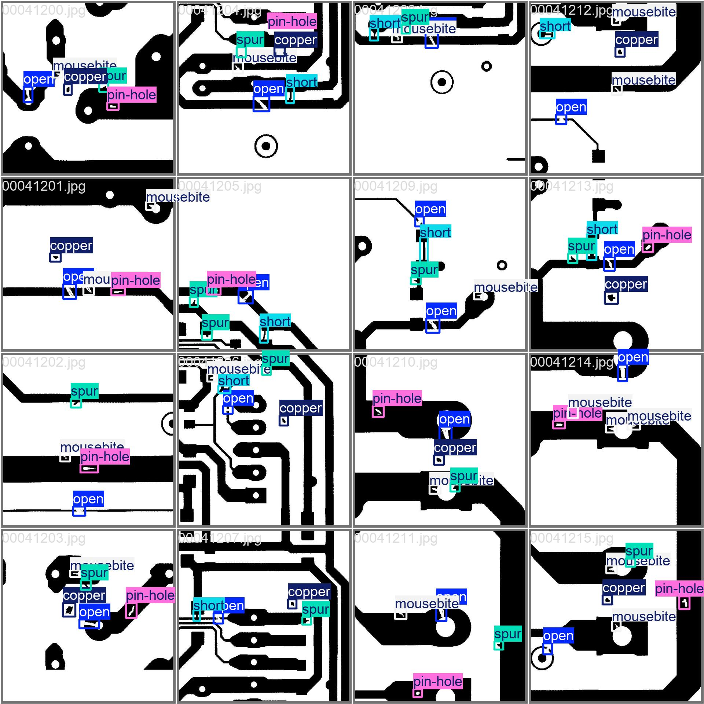
  &nbsp;
  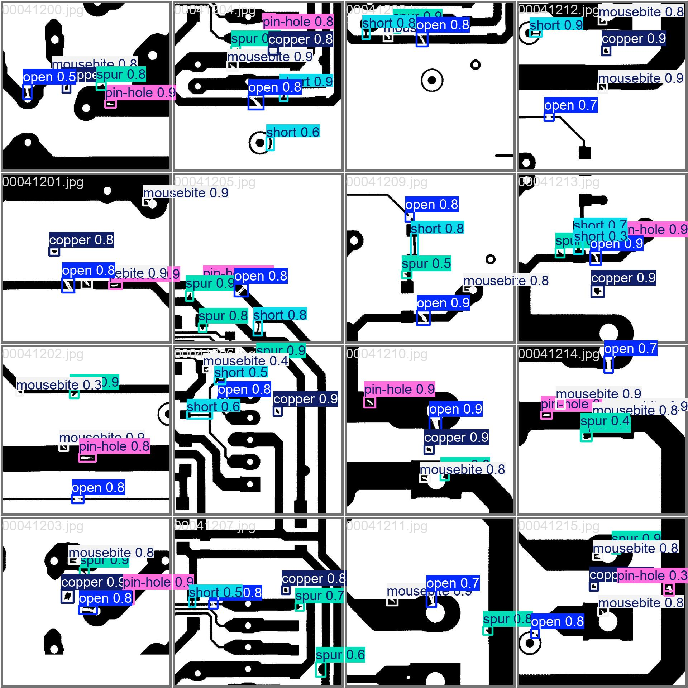
  <br>
  <em>Esquerda: anotações do dataset. Direita: predições do modelo nas mesmas imagens de validação.</em>
</p>

---

## Sumário

1. [O problema](#1-o-problema)
2. [Dataset](#2-dataset)
3. [Treino](#3-treino)
4. [Resultados](#4-resultados)
5. [Análise do treino](#5-análise-do-treino)
6. [Testes com imagens fora do dataset](#6-testes-com-imagens-fora-do-dataset)
7. [Próximos passos](#7-próximos-passos)
8. [Como reproduzir](#8-como-reproduzir)
9. [Estrutura do repositório](#9-estrutura-do-repositório)
10. [Referências e licença](#10-referências-e-licença)

---

## 1. O problema

Na fabricação de PCBs, a inspeção óptica automática (AOI) procura falhas nas trilhas de cobre antes da montagem dos componentes. Um defeito pequeno — uma trilha interrompida ou um filete de cobre ligando duas trilhas — pode inutilizar a placa. O objetivo aqui é um detector que receba a imagem de uma placa e devolva **onde** está cada defeito e **qual** é o tipo:

| Classe | Defeito | Efeito elétrico típico |
|---|---|---|
| `open` | trilha interrompida | circuito aberto |
| `short` | ponte de cobre entre trilhas | curto-circuito |
| `mousebite` | "mordida" na borda da trilha | estreitamento, aquecimento, risco de abrir |
| `spur` | protuberância saindo da trilha | redução de isolação, risco de curto |
| `copper` | ilha de cobre espúrio | risco de curto |
| `pin-hole` | furo indevido no cobre | redução de seção condutora |

## 2. Dataset

O [DeepPCB](https://github.com/tangsanli5201/DeepPCB) (Tang et al., 2019) tem 1.500 pares de imagens 640×640: um template sem defeito e a imagem testada, com os defeitos anotados por caixas. As imagens vieram de um scanner linear CCD com cerca de 48 pixels por milímetro e foram **alinhadas e binarizadas** (cobre preto, substrato branco).

Neste projeto uso **apenas a imagem testada** (detecção em imagem única, sem o template) e a divisão original do dataset:

| Classe | Treino (1000 imagens) | Validação (500 imagens) |
|---|---:|---:|
| open | 1283 | 659 |
| short | 1028 | 478 |
| mousebite | 1379 | 586 |
| spur | 1142 | 483 |
| copper | 1010 | 464 |
| pin-hole | 1031 | 470 |
| **total** | **6873** | **3140** |

As classes são bem balanceadas, e todas as imagens têm pelo menos um defeito (0 imagens de fundo puro). Os objetos são **pequenos**: a caixa mediana tem 35×33 px numa imagem de 640×640 (cerca de 0.3% da área), com 80% das caixas entre ~28 e ~54 px de largura. Esse detalhe vai ser importante na [análise](#5-análise-do-treino).

<p align="center">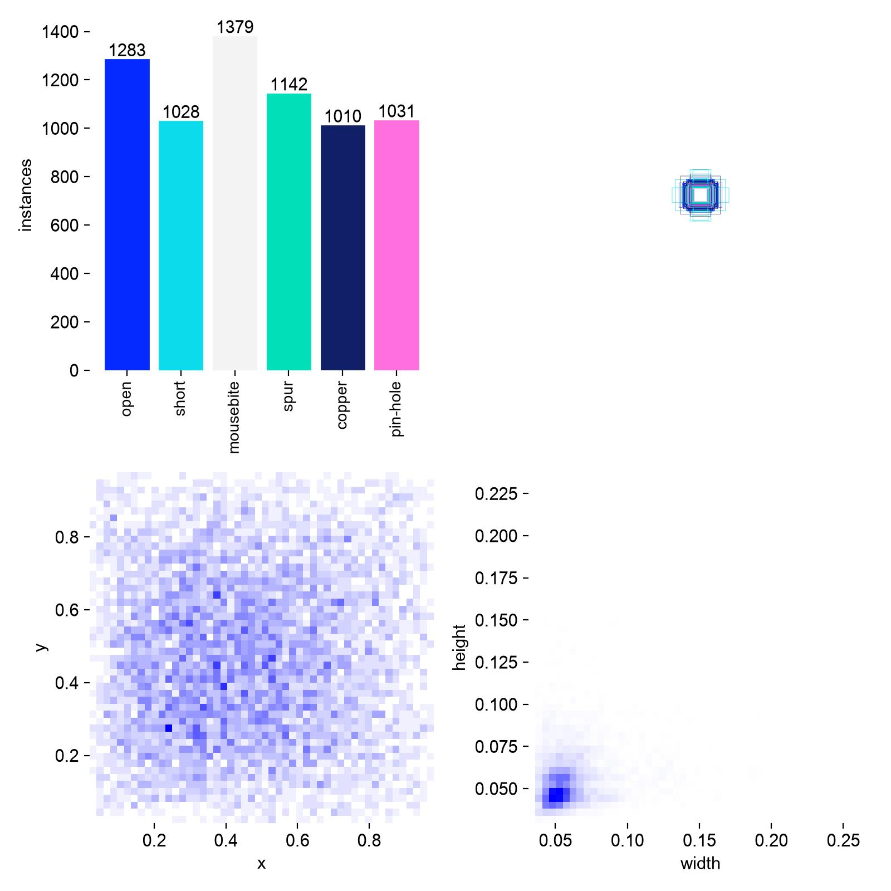</p>

## 3. Treino

### 3.1 Por que o YOLO26n (e não um modelo maior)

Sem GPU, o custo por época decide o que é viável. Comecei com o **YOLO26m** e interrompi depois de 7 épocas:

| Modelo | Tempo por época (CPU) | 150 épocas levariam |
|---|---:|---:|
| YOLO26m | ~24 min | ~60 h |
| **YOLO26n** | **~4 min** | **~10 h** |

O nano é ~6× mais rápido por época, o que permitiu um treino completo em uma tarde. O histórico parcial do modelo médio está em [`results/yolo26m_interrompido/`](results/yolo26m_interrompido/) — e ele já mostrava a mesma oscilação de mAP50-95 discutida na seção 5 (0.19 → 0.45 → 0.08 → 0.35 → 0.68 → 0.35 → 0.33 nas 7 épocas), um indício de que o fenômeno não é exclusivo do modelo pequeno.

### 3.2 Configuração

Todos os hiperparâmetros estão em [`results/yolo26n/args.yaml`](results/yolo26n/args.yaml) e o script em [`src/train.py`](src/train.py). As escolhas principais:

| Parâmetro | Valor | Motivo |
|---|---|---|
| `imgsz` | 832 | ampliar as imagens de 640 dá mais pixels aos defeitos pequenos nas camadas de detecção |
| `epochs` / `patience` | 150 / 80 | teto de épocas com parada antecipada |
| `optimizer` | auto → **AdamW, lr = 0.001** | escolhido pela Ultralytics por haver menos de 10 mil iterações |
| `cos_lr` | True | decaimento cossenoidal da taxa de aprendizado |
| `close_mosaic` | 30 | desligar o mosaic nas 30 últimas épocas para estabilizar |
| `hsv_h`, `hsv_s` | 0 | as imagens são binárias, variar matiz/saturação não faz sentido |
| `degrees`, `shear`, `perspective` | 0 | as trilhas seguem ângulos fixos; rotações livres criariam geometrias irreais |
| `fliplr`, `flipud` | 0.5 | espelhar uma placa continua gerando uma placa plausível |
| `translate`, `scale` | 0.1 / 0.3 | variação leve de posição e escala |
| `mosaic` | 1.0 | mais defeitos e contextos por imagem de treino |
| `cache` | ram | 1.9 GB em RAM, elimina leitura de disco |

**Ambiente:** Ultralytics 8.4.214 · PyTorch 2.15.0 (CPU) · Python 3.12.10 · AMD Ryzen 9 9950X3D (16 núcleos) · Windows. O log completo está em [`results/yolo26n/train_log.txt`](results/yolo26n/train_log.txt).

## 4. Resultados

Métricas do `best.pt` (época 11) na validação final da Ultralytics:

| Classe | Instâncias | Precisão | Revocação | mAP50 | mAP50-95 |
|---|---:|---:|---:|---:|---:|
| open | 659 | 0.968 | 0.941 | 0.981 | 0.644 |
| short | 478 | 0.817 | 0.866 | 0.904 | 0.583 |
| mousebite | 586 | 0.977 | 0.944 | 0.972 | 0.680 |
| spur | 483 | 0.970 | 0.892 | 0.971 | 0.665 |
| copper | 464 | 0.984 | 0.946 | 0.987 | 0.819 |
| pin-hole | 470 | 0.910 | 0.966 | 0.985 | 0.789 |
| **todas** | **3140** | **0.938** | **0.926** | **0.967** | **0.697** |

<p align="center">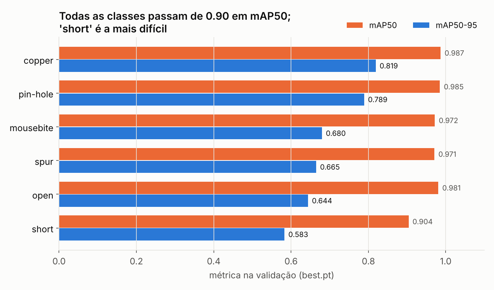</p>

**Leitura por classe**

- **`copper` e `pin-hole` são as mais fáceis** (mAP50-95 ≈ 0.8). São defeitos compactos e de contorno bem definido — uma ilha preta isolada ou um furo branco dentro do cobre —, então a caixa "encaixa" com facilidade.
- **`short` é a mais difícil** em todas as métricas, e o problema é sobretudo **precisão** (0.817): o modelo vê "curtos" onde não há. Na curva PR abaixo, `short` é a única classe cuja precisão cai de forma visível antes de 80% de revocação.
- **`spur` tem a menor revocação** (0.892): parte das protuberâncias pequenas passa despercebida.

### 4.1 Matriz de confusão

<p align="center">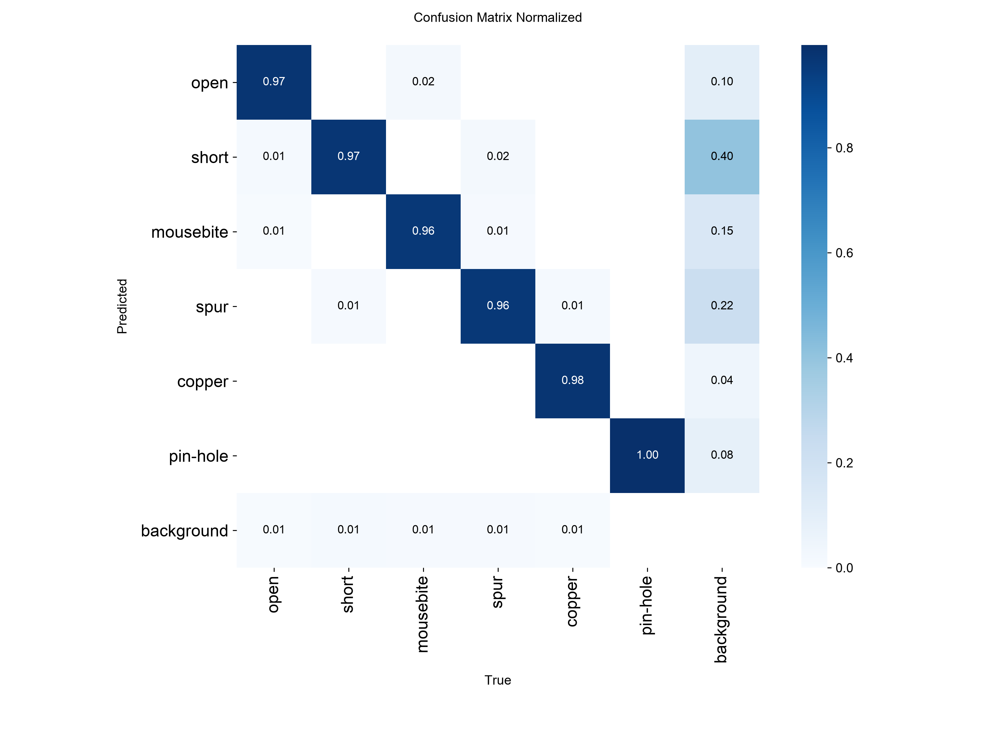</p>

A diagonal fica entre 0.96 e 1.00 e quase nada aparece fora dela entre classes de defeito: **o modelo praticamente não confunde um tipo de defeito com outro**. Os erros que existem são de outro tipo:

- **Falsos positivos** (coluna *background*): de todas as detecções que não correspondem a nenhum defeito real, **40% são `short`**, 22% `spur` e 15% `mousebite`. É o mesmo diagnóstico da tabela: o modelo tende a interpretar regiões estreitas entre trilhas como curto.
- **Falsos negativos** (linha *background*): ~1% dos defeitos de cada classe não é detectado (nenhum no caso de `pin-hole`).

### 4.2 Curvas de precisão-revocação e F1

<p align="center">
  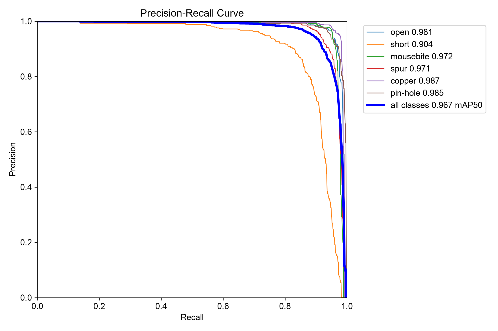
  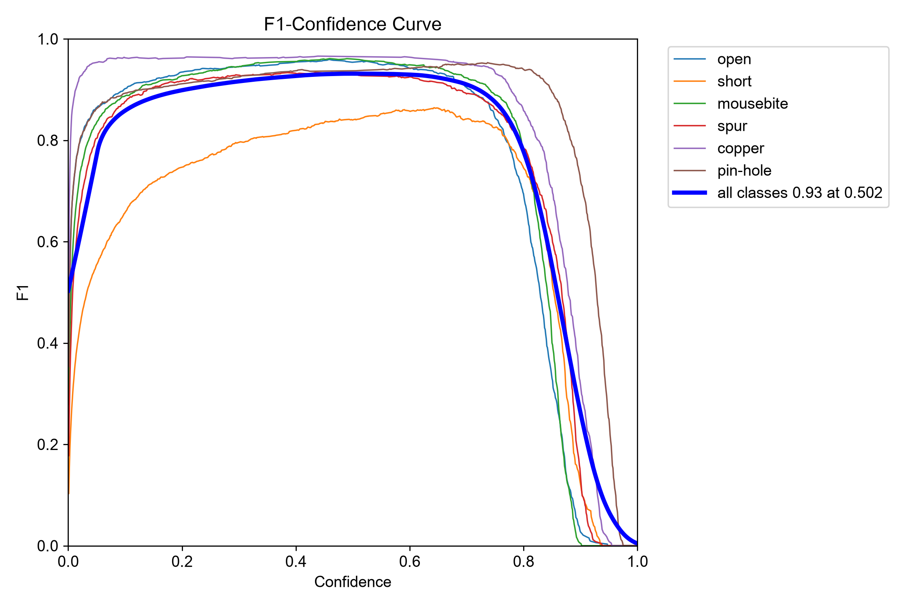
</p>

O F1 global atinge **0.93 com limiar de confiança de 0.502** e fica praticamente plano entre ~0.3 e ~0.7. Por isso o [`src/predict.py`](src/predict.py) usa `conf=0.5` como padrão, em vez do 0.25 da Ultralytics. Para `short`, o F1 máximo é menor (~0.86) e ocorre num limiar mais alto (~0.65), coerente com o excesso de falsos positivos.

## 5. Análise do treino

### 5.1 O que aconteceu

O treino foi configurado para 150 épocas, mas **parou na época 91 por parada antecipada**: o melhor resultado de validação ocorreu na **época 11** e nenhuma das 80 épocas seguintes o superou (`patience=80`). O `best.pt` publicado é, portanto, o modelo da época 11.

<p align="center">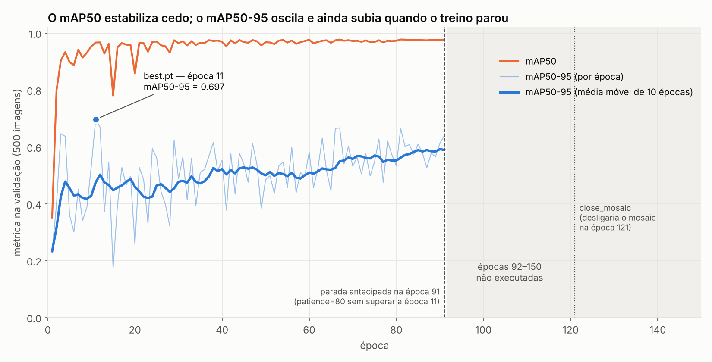</p>

O gráfico mostra dois comportamentos bem diferentes:

- **mAP50 converge cedo e fica estável**: passa de 0.95 por volta da época 10 e termina em 0.977. Depois da época 11, o desvio-padrão entre épocas é de apenas **0.026**.
- **mAP50-95 oscila muito de uma época para outra**: depois da época 11, variou entre **0.173 e 0.669** (desvio-padrão **0.093**, 3.6× maior). Ainda assim, a **média móvel de 10 épocas subiu de forma consistente**: 0.46 (épocas 11–20) → 0.50 (41–50) → **0.59 (82–91)**.

As perdas de treino (`train/box_loss`, `train/cls_loss`) caem de forma suave durante todo o treino ([`results.png`](results/yolo26n/results.png)), então o modelo não estava divergindo: a instabilidade aparece **só na validação** e só na métrica que exige caixas justas.

### 5.2 A oscilação é de localização

O mAP50 conta uma detecção como certa se a caixa tiver IoU ≥ 0.5 com a anotação; o mAP50-95 faz a média de 0.5 a 0.95, ou seja, exige caixas cada vez mais justas. Se o mAP50 está estável e o mAP50-95 não, **o modelo encontra e classifica os defeitos de forma consistente, mas o ajuste fino das caixas varia de época para época**.

<p align="center">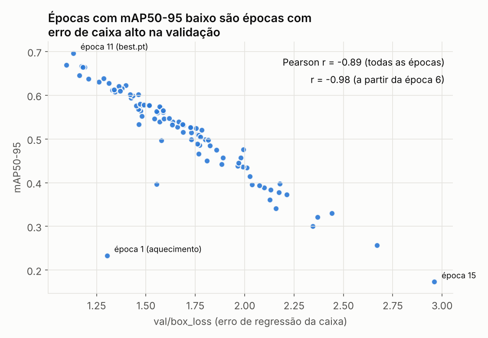</p>

Os números confirmam: a correlação entre `val/box_loss` e mAP50-95 é **r = −0.89** em todas as épocas e **r = −0.98** a partir da época 6. Épocas com mAP50-95 baixo são exatamente as épocas em que o erro de regressão de caixa na validação dispara (época 15: `val/box_loss` = 2.96 e mAP50-95 = 0.17).

**Por que objetos pequenos amplificam isso.** Para uma caixa de 35×33 px (o tamanho mediano do dataset), deslocar a predição em *d* pixels na horizontal e na vertical dá:

| deslocamento | IoU |
|---:|---:|
| 1 px | 0.89 |
| 2 px | 0.79 |
| 3 px | 0.71 |

Um erro de 3 pixels já faz a detecção falhar nos limiares de 0.75 a 0.95 — metade dos 10 limiares que compõem o mAP50-95 — enquanto ela continua valendo para o mAP50. Em objetos grandes, o mesmo erro seria irrelevante.

**Hipóteses complementares** (não testadas isoladamente):

- **Margem das anotações:** 80% das caixas ficam entre ~28 e ~54 px de largura, uma faixa estreita para defeitos de tamanhos muito diferentes. Isso sugere caixas desenhadas com uma margem padrão em volta do defeito, e não justas ao contorno. Se o alvo da regressão é ambíguo, a caixa predita tende a oscilar em torno dele.
- **Mosaic ativo do começo ao fim:** com `close_mosaic=30`, o mosaic só seria desligado na época 121, que nunca chegou. As imagens de treino eram sempre mosaicos, enquanto a validação usa imagens inteiras.
- **Taxa de aprendizado ainda alta:** na época 91 a taxa estava em 3.5×10⁻⁴, contra 1×10⁻⁵ previsto para o fim do cosseno. A fase de ajuste fino, em que os pesos variam pouco e a localização costuma estabilizar, não aconteceu.

### 5.3 Consequência: o `best.pt` é um pico, não a tendência

A Ultralytics escolhe o `best.pt` por uma métrica de *fitness* baseada essencialmente no mAP50-95, justamente a métrica ruidosa. A época 11 foi um pico isolado (as épocas 10 e 12 tiveram 0.53 e 0.67), e a parada antecipada passou 80 épocas comparando o modelo contra esse pico, mesmo com a tendência ainda subindo.

Comparando os dois pesos salvos:

| Pesos | Época | Precisão | Revocação | mAP50 | mAP50-95 |
|---|---:|---:|---:|---:|---:|
| `weights/best.pt` | 11 | 0.937 | 0.928 | 0.967 | **0.697** |
| `weights/last.pt` | 91 | **0.969** | **0.953** | **0.977** | 0.639 |

<sub>Valores registrados na validação de cada época durante o treino (`results.csv`). A validação final do `best.pt`, refeita pela Ultralytics no fim do treino, deu 0.938 / 0.926 / 0.967 / 0.697.</sub>

O `last.pt` erra menos (mais precisão e mais revocação) e só perde em justeza de caixa. Para **inspeção**, em que o importante é sinalizar a região defeituosa para um operador ou reprovar a placa, o `last.pt` provavelmente é o mais útil. O `best.pt` é melhor se a medida exata da caixa importar. Os dois estão no repositório; os números da tabela vêm da validação feita a cada época durante o treino, e a validação completa do `last.pt` pode ser repetida com `yolo val model=weights/last.pt data=data/deeppcb.yaml imgsz=832`.

### 5.4 Ressalva sobre a avaliação

O conjunto de "validação" aqui é o conjunto de **teste** oficial do DeepPCB, e ele foi usado também para escolher a melhor época. Isso torna os números levemente otimistas, já que não há um conjunto 100% intocado. O artigo original do DeepPCB reporta 98.6% de mAP, mas usando o par template + imagem testada e um protocolo de avaliação próprio, então os números **não são diretamente comparáveis**.

## 6. Testes com imagens fora do dataset

Para ver o comportamento fora do DeepPCB, rodei o modelo em duas imagens reais.

| Placa montada (foto de celular) | Placa nua (imagem em tons de cinza) |
|---|---|
| 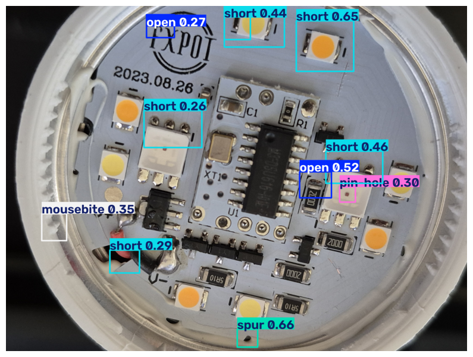 | 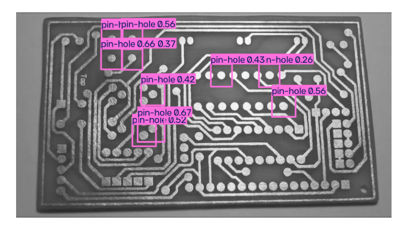 |
| 11 detecções, todas **falsos positivos**: LEDs, resistores SMD e bordas foram marcados como defeito, a maioria como `short` (6 de 11). Confianças entre 0.26 e 0.66. | 10 detecções de `pin-hole`, todas em **ilhas de componentes PTH** (pad com furo de broca). Confianças entre 0.26 e 0.67. |

**Interpretação.** Os dois resultados são casos de *domain shift*, e são informativos:

- O modelo nunca viu **componentes montados, cor, sombras ou perspectiva**. Diante de algo fora da distribuição, ele cai na classe que mais gera falsos positivos também na validação (`short`).
- Na placa nua, **a polaridade está invertida em relação ao DeepPCB**. No dataset, o cobre é preto e o substrato branco, e um pin-hole é justamente um ponto claro dentro de uma área escura. Nessa imagem o cobre aparece claro sobre substrato escuro, então cada pad com furo vira, para o modelo, "um círculo claro cercado de escuro": a assinatura de um pin-hole. A escala diferente (a imagem tem resolução bem menor que os ~48 px/mm do dataset) reforça a confusão.
- Os dois testes usaram o limiar padrão de 0.25. A foto de celular foi passada colorida e sem pré-processamento. A placa nua foi passada em tons de cinza, **sem a binarização** (no notebook original, a imagem binarizada era calculada mas não era a que ia para o modelo) e com `imgsz=640`, enquanto o treino usou 832. Com `conf=0.5`, sobrariam 3 detecções na primeira imagem e 5 ou 6 na segunda. O `predict.py` corrige esses pontos (`--binarize` com inversão de polaridade, `imgsz=832`, `conf=0.5`), e repetir esses testes com ele é o próximo experimento.

**Conclusão:** o modelo aprendeu bem o domínio do DeepPCB, mas não está pronto para fotos arbitrárias. Para uso real, é preciso reproduzir o pipeline de aquisição do dataset (iluminação controlada, alinhamento, binarização e resolução próxima de 48 px/mm) ou fazer fine-tuning com imagens reais anotadas.

## 7. Próximos passos

1. **Treinar até o fim**: `patience=0` (ou ≥ 150) para chegar ao `close_mosaic` e ao fim do cosseno, e então comparar `best.pt` × `last.pt` de novo.
2. **Separar validação e teste**: tirar ~100 imagens do `trainval` para escolher a época e deixar as 500 de teste intocadas até a avaliação final.
3. **Atacar a oscilação de localização**: comparar SGD × AdamW, `close_mosaic` maior e `imgsz` 640 × 832 × 1024.
4. **Usar o template**: o DeepPCB fornece a imagem sem defeito alinhada; usar a diferença template − teste como canal extra é o que o artigo original faz.
5. **Modelos maiores com GPU** (Colab/Kaggle): YOLO26s/m em tempo viável.
6. **Imagens reais**: montar um pequeno conjunto anotado de placas fotografadas e fazer fine-tuning.
7. **Implantação em CPU**: exportar para ONNX/OpenVINO (`yolo export model=weights/best.pt format=openvino`) e medir o ganho de latência.

## 8. Como reproduzir

```bash
git clone https://github.com/<seu-usuario>/pcb-defect-detection-yolo26.git
cd pcb-defect-detection-yolo26
pip install -r requirements.txt
```

**Dados** — baixe o [DeepPCB](https://github.com/tangsanli5201/DeepPCB) e converta para o formato YOLO (gera `data/images` e `data/labels`):

```bash
python src/prepare_deeppcb.py --src caminho/para/DeepPCB/PCBData
```

**Treino** (mesma configuração do experimento documentado):

```bash
python src/train.py
python src/train.py --patience 0      # sugestão: sem parada antecipada
```

**Gráficos de análise** a partir do `results.csv`:

```bash
python src/analyze_results.py --csv runs/yolo26n_cpu_max/results.csv --out results/analise
```

**Inferência** em uma imagem ou pasta:

```bash
python src/predict.py imagem.jpg
python src/predict.py pasta_de_fotos/ --binarize --weights weights/last.pt
```

## 9. Estrutura do repositório

```
├── data/
│   └── deeppcb.yaml              # classes e caminhos do dataset
├── src/
│   ├── prepare_deeppcb.py        # DeepPCB original -> formato YOLO
│   ├── train.py                  # treino (hiperparâmetros do experimento)
│   ├── analyze_results.py        # gráficos e números da seção 5
│   └── predict.py                # inferência, com binarização opcional
├── weights/
│   ├── best.pt                   # época 11 (maior mAP50-95)
│   └── last.pt                   # época 91 (maior precisão, revocação e mAP50)
└── results/
    ├── yolo26n/                  # saídas da Ultralytics: curvas, matrizes, results.csv, log
    ├── yolo26m_interrompido/     # tentativa com o modelo médio (7 épocas)
    ├── analise/                  # gráficos da análise do treino
    └── testes_reais/             # predições em imagens fora do dataset
```

## 10. Referências e licença

- S. Tang, F. He, X. Huang, J. Yang. *Online PCB Defect Detector On A New PCB Defect Dataset*. arXiv:1902.06197, 2019. Dataset: [github.com/tangsanli5201/DeepPCB](https://github.com/tangsanli5201/DeepPCB) (licença MIT).
- [Ultralytics YOLO](https://github.com/ultralytics/ultralytics) — biblioteca de treino e modelos YOLO26.

O código deste repositório está sob a licença MIT (ver [`LICENSE`](LICENSE)). A biblioteca Ultralytics e os pesos pré-treinados YOLO26, dos quais os arquivos em `weights/` derivam, são distribuídos pela Ultralytics sob AGPL-3.0.
